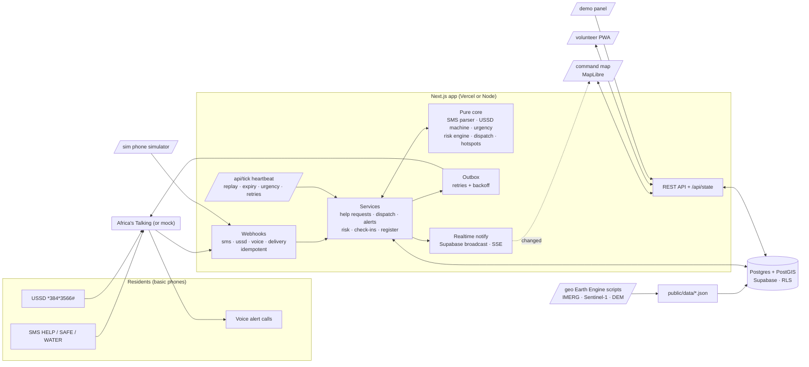

# FloodGuard

**From early warning to rescue for flood-prone Nigerian communities.**
ISF × ATC Africa BuildAthon — ClimateTech track. Demo area: **Lokoja, Kogi State** (Niger–Benue confluence, severely flooded in 2022).

- **Sense:** satellite rainfall (NASA IMERG), Sentinel-1 radar flood extent, terrain-based risk zones, crowd reports.
- **Warn & connect:** SMS / USSD / voice alerts in English, Pidgin, Hausa, Yoruba and Igbo; one-step help requests from basic phones; "I'm safe" check-ins; a vulnerable-people register.
- **Respond:** a live god's-eye command map for SEMA operators, plus ride-hailing-style dispatch for volunteers and boat owners.

> All people, phone numbers and messages in this repository are **fake**. Satellite data files are currently **synthetic stand-ins** with the real schema (see [Data sources](#data-sources-and-licences)).

---

## Quick start (local, ~10 minutes)

Requirements: Node 20+, Docker (or any Postgres 15+ with PostGIS).

```bash
git clone <this repo> && cd flood-guard
docker compose up -d db          # PostGIS on localhost:54329
cp .env.example .env             # defaults work for local demo mode
npm install
npm run setup                    # migrations + Lokoja seed data
npm run dev                      # http://localhost:3000
```

Then open:

| Page | What | Access |
|---|---|---|
| `/command` | God's-eye command map | operator login, or "Demo mode: enter" on `/login` |
| `/demo` | Demo control panel | `/demo?key=floodguard-demo` (`DEMO_KEY`) |
| `/sim` | Basic-phone simulator (SMS + USSD into the real webhooks) | demo mode |
| `/volunteer` | Volunteer PWA | phone `+2348001000001`, OTP `123456` in demo mode |
| `/register`, `/report` | Vulnerable-people register, crowd report form | public |
| `/privacy`, `/roadmap` | Plain-language NDPA notice, post-flood roadmap | public |

Operator accounts: `operator@floodguard.demo` / `admin@floodguard.demo`, password `floodguard-demo` (`SEED_OPERATOR_PASSWORD`).

Everything also runs with one command: `docker compose up --build` (app on :3000, migrates + seeds on first start).

---

## 60-second demo script

Two screens: **projector** shows `/command`; **laptop** shows `/demo` and `/sim`; a **phone** has `/volunteer` open and logged in as the demo captain.

1. **(0:00) Sense.** `/demo` → **Reset demo** → **Start rainfall replay**. On the projector the rainfall heat map builds over Lokoja (IMERG, 1–5 Oct 2022). Gadumo/Kpata and Ganaja turn **HIGH**. The zone panel explains why: *"Rain 79mm/24h · Historically flooded (2022) · Low-lying terrain"*.
2. **(0:15) Warn.** Alerts go out automatically to every registered resident in those zones, by SMS and voice, each in their own language. The message log on `/demo` shows Pidgin and English. Hausa speakers get English and are flagged "needs native review". Click a zone → **📻 Radio script** for community radio.
3. **(0:25) Ask for help.** On `/sim`, as *Mama Ngozi (Gadumo, Pidgin, elderly + child)*, type **`HELP 3 people roof`**. She gets a reply in Pidgin with reference **FG-1001**.
4. **(0:30) See it.** The pin drops on the projector and pulses (vulnerable household). It goes to the top of the queue with urgency **64** and the reasons: *Zone HIGH +30, elderly + child under 5 +20, on roof +10…*
5. **(0:35) Dispatch.** The nearest boat (the demo captain's phone) gets the offer with a 2-minute countdown. Tap **Accept**, then tick **"simulate my travel"**. The boat moves across the map towards her.
6. **(0:50) Rescue.** Tap **Rescued**. The pin turns green, the shelter occupancy bar goes up, and her son and daughter get *"Dem don rescue Mama Ngozi Adefake, e dey safe"* (visible in `/demo`'s log).
7. **(Optional) Scale.** **Inject 10 help requests** and switch on **Autopilot**. A hotspot ring appears, simulated volunteers accept and move, and the timeline slider replays the whole event.

The same flow runs automatically in `tests/e2e/core-flow.spec.ts` (≈11 s).

**Demo video:** `node scripts/record-demo.cjs` records the whole flow (command map, phone simulator and volunteer app side by side, with captions) as a ~2-minute 1080p video. It resets the demo data first.

---

## Architecture



**Key decisions**

- **One Next.js app.** API routes are the backend. The server talks to Postgres directly over `DATABASE_URL` (Supabase pooler or local PostGIS). This keeps PostGIS queries, transactions and advisory locks simple, and the same code runs locally and on Supabase.
- **Live updates without refresh.** After every change the server sends a "something changed" signal with no personal data. It goes out on a Supabase Realtime broadcast channel when configured, or as server-sent events (`/api/stream`) otherwise. Dashboards then refetch `/api/state`, which enforces auth. Polling every 5 s is the safety net.
- **Serverless-friendly timing.** Offer expiry (2 min), waiting-time urgency, rainfall replay, simulated volunteers and message retries all run in an idempotent, throttled `/api/tick`. Open dashboards call it every 1–5 s. For unattended operation, schedule it every minute with Supabase pg_cron (`supabase/optional/pg_cron_tick.sql`).
- **USSD is stateless.** Africa's Talking sends the whole path (`1*4*1*3*1`), so the menu is a pure function of path + context. There are no session tables, and provider retries give identical answers.
- **Pure, tested core.** The parser, USSD machine, urgency, risk, dispatch, hotspots, crowd verification and dedupe/alert policies live in `src/lib/core/` with no I/O.

### Folder structure

```
config/regions/        region config (zones, landmarks, shelters, volunteers) → switch region here
content/alerts/        message templates per language (en, pcm final/draft; ha, yo, ig NEEDS_NATIVE_REVIEW)
geo/                   Earth Engine scripts (IMERG, Sentinel-1 flood, DEM risk)
public/data/           committed outputs of /geo (+ zones, offline basemap)
public/audio/          voice recordings per language/level (to be recorded)
scripts/               migrate, seed, synthetic data generator
supabase/migrations/   PostGIS schema + RLS
src/lib/core/          pure logic (unit tested)
src/lib/services/      DB-backed services (help requests, dispatch, alerts, risk, tick, demo, state)
src/lib/messaging/     MessagingProvider (mock, Africa's Talking) + outbox
src/app/               pages (/command, /volunteer, /sim, /demo, /register, /report, …) and /api routes
tests/unit, tests/e2e  Vitest + Playwright
```

---

## How the scores work (explainability)

**Zone risk** (`src/lib/core/risk.ts`), shown with reasons on the dashboard:

```
score = 0.35·base_risk + 0.35·max(rain24h/100mm, rain72h/200mm) + 0.15·min(reports24h/6, 1) + 0.15·satellite_overlap
low < 0.35 ≤ medium < 0.55 ≤ high < 0.75 ≤ severe        (drops a level only 0.05 below the threshold)
```
`satellite_overlap` counts only while a Sentinel-1 extent is current (≤ 14 days old at the simulated time). Operators can raise a zone, never lower it below the computed level.

**Urgency 0–100** (`src/lib/core/urgency.ts`), every point attributed to a reason:
zone risk (low 5 / medium 15 / high 30 / severe 40) + vulnerable members (bedridden 15, disabled 12, elderly/pregnant/child under 5 10, +50 % per extra person, cap 30) + people (+2 each after the first, cap 15) + waiting (+3 per 10 min, cap 15) + keywords (drowning 15, roof 10, baby/pikin 8, water rising 8, sick 6, trapped 6…, cap 20) + failed attempts (+10 each).

**Dispatch** (`src/lib/core/dispatch.ts`): effective distance = straight-line distance × type factor (inside flood polygons: boat 1, medical 2.5, on foot 3, vehicle 4; outside: vehicle/medical 1, on foot 1.3, boat 1.6) × capacity penalty. The most urgent request picks first; each volunteer gets one offer at a time; offers expire after 2 minutes and go to the next volunteer. Volunteers who declined are not asked again.

**Duplicates:** the same phone within 30 minutes merges into the open request (people count, notes, better location), with no new pin. **Alerts:** never below MEDIUM, always on escalation, the same level again only after a 6 h cooldown. This stops flickering risk from spamming residents.

---

## Data model

The brief's tables are all present (`supabase/migrations/0001_schema.sql`). I made these changes:

| Change | Why |
|---|---|
| `landmarks` table | USSD "nearest landmark" lists and SMS landmark matching |
| `location_source` adds `unknown` | an unregistered SMS with no landmark is still accepted; the resident is asked to reply with a landmark |
| `help_requests` + `ref_code`, `urgency_reasons`, `vulnerable` snapshot, `inside_flood`, `channel`, `merged_count`, `failed_attempts`, `close_reason` | references in replies, explainability, dispatch, audit |
| `rescue_jobs` + `status`, `expires_at`, `operator_assigned` | ride-hailing offers; partial unique indexes give one live job per volunteer and per request |
| `residents.email`, `family_contacts.email`, email columns on `outbound_messages`, `help_requests.ops_notified_at` (migration 0003); `residents.email_verified_at`, `email_opt_out`, unique email (migration 0004) | email channel via Brevo with double opt-in |
| `inbound_messages` (unique provider id), `outbound_messages` (queue) | idempotent webhooks; retries with backoff; demo message log |
| `alert_deliveries` | per-resident de-duplication of alerts |
| `rainfall_readings`, `flood_extents`, `zone_risk_snapshots` | risk engine inputs and the timeline slider |
| `volunteer_positions` | movement history (recorded only during active jobs) for timeline replay |
| `residents.alerts_opt_out`, `is_seed`, `registered_by`; `home` requires `consent_location` (CHECK) | NDPA consent, STOP, community registration |
| `app_users`, `otp_codes`, `demo_state` | operator login, volunteer OTP, demo clock |

**Security:** RLS is enabled on every table (`0002_rls.sql`). Operators/admins (JWT claim `app_role`) can read operational tables, volunteers can read their own row and jobs, and anon can read nothing personal. The Next.js server connects as the table owner and enforces roles in each API route. Operator sessions and volunteer OTP sessions are signed, httpOnly cookies. Phone numbers are masked on the dashboard; the assigned volunteer sees the full number; an operator "reveal" is written to `audit_log`. Every status change is audited.

---

## Switching region

1. Copy `config/regions/lokoja.ts` to `config/regions/<id>.ts`. Set zones (polygons, base risk), landmarks, shelters, volunteers, USSD code and replay window. Register it in `config/regions/index.ts`.
2. `REGION=<id> NEXT_PUBLIC_REGION=<id> npm run data:synthetic` to create stand-in data files, **or** run the `/geo` scripts for real data.
3. `REGION=<id> npm run db:seed`, set `REGION`/`NEXT_PUBLIC_REGION` in `.env`, restart.

## Switching to real Africa's Talking

1. Create an Africa's Talking app (start with the sandbox: `AT_USERNAME=sandbox`). Get an API key, an SMS shortcode or sender ID, a USSD code and a voice number.
2. `.env`: `MESSAGING_PROVIDER=africastalking`, `AT_USERNAME`, `AT_API_KEY`, `AT_SENDER_ID`, `AT_VOICE_NUMBER`, `PUBLIC_BASE_URL=https://your-app`, and a random `WEBHOOK_SECRET`.
3. In the AT dashboard set the callback URLs (append `?token=<WEBHOOK_SECRET>`):
   - SMS inbox → `/api/webhooks/sms`
   - SMS delivery reports → `/api/webhooks/delivery`
   - USSD → `/api/webhooks/ussd`
   - Voice callback → `/api/webhooks/voice`
4. Put recordings in `public/audio/{lang}/alert_{level}.mp3`. Until then, voice calls read the transcript with text-to-speech.

The `MessagingProvider` interface (`src/lib/messaging/provider.ts`) makes other gateways (Termii, Twilio, a local telco) a single class.

## Email notifications (Brevo)

Email is an extra channel alongside SMS/voice, sent through the same outbox (retries, backoff, visible in the `/demo` log):

| Who | When | Content |
|---|---|---|
| SEMA staff (`OPS_NOTIFY_EMAILS`) | a zone rises to **HIGH/SEVERE** | level change, reasons, residents + vulnerable households, link to `/command` |
| SEMA staff | a help request **first reaches** urgency ≥ `OPS_NOTIFY_MIN_URGENCY` (default 70) — at creation or later as zone risk/waiting time grow; once per request | urgency breakdown, people, location precision |
| Residents with a **confirmed** email | flood alerts (MEDIUM+), same de-duplication as SMS | alert in their language (English fallback) + unsubscribe link |
| Family contacts with an email | rescue completed or SAFE check-in | "{name} is safe" |

**Sign-up on the landing page.** Residents enter name, email, phone, area and language on `/` (phone stays required: SMS works without data and help requests are matched by phone). The email is **double opt-in**: FloodGuard sends a signed "Confirm my email" link (at most one per address every 10 minutes, so the public form can't be used to spam someone), and alert emails start only after it is clicked. Every alert email has a one-click unsubscribe link; SMS alerts are unaffected (STOP for those). One email address belongs to one phone. In demo mode with `EMAIL_PROVIDER=mock`, the confirm link is shown on screen.

Setup:
1. Create a Brevo account → **Senders, Domains & Dedicated IPs → Senders**: add and verify the sender address (authenticate your domain for better deliverability).
2. **SMTP & API → API Keys**: create a key.
3. Set `EMAIL_PROVIDER=brevo`, `BREVO_API_KEY`, `EMAIL_FROM` (the verified sender), `EMAIL_FROM_NAME`, `OPS_NOTIFY_EMAILS=ops1@…,ops2@…`.

With `EMAIL_PROVIDER=mock` (default) emails are only logged. Seed data uses `@example.com` addresses, which never deliver. Brevo's free plan sends 300 emails/day — fine for staff notifications and families; for mass resident alerts use a paid plan. Email addresses are optional and collected with the same consent as phone numbers; `DELETE` by SMS erases them.

## Deploying (Vercel + Supabase)

1. **Supabase:** create a project → *Database → Extensions*: enable `postgis`. Copy the connection strings.
2. **Migrate + seed** from your machine using the **session/direct** connection string:
   `DATABASE_URL=<direct url> npm run setup`
3. **Vercel:** import the repo and set environment variables:
   - `DATABASE_URL` = the **transaction pooler** URL (port 6543)
   - `AUTH_SECRET`, `DEMO_MODE`, `DEMO_KEY`, `MESSAGING_PROVIDER=mock`, `PUBLIC_BASE_URL=https://<app>.vercel.app`
   - for instant cross-instance live updates: `NEXT_PUBLIC_SUPABASE_URL`, `NEXT_PUBLIC_SUPABASE_ANON_KEY`, `SUPABASE_SERVICE_ROLE_KEY`
   - optional: `CRON_SECRET`, `ORS_API_KEY`, and the Brevo variables (`EMAIL_PROVIDER`, `BREVO_API_KEY`, `EMAIL_FROM`, `OPS_NOTIFY_EMAILS`)
4. Optional unattended heartbeat: run `supabase/optional/pg_cron_tick.sql` (with your URL and `CRON_SECRET`).

On Vercel, `/api/stream` (SSE) cannot see events from other instances. Set the Supabase Realtime variables, or dashboards fall back to 5-second polling, which still works.

---

## Tests

```bash
npm test                                   # 80+ unit tests: SMS parsing, USSD state machine, urgency, risk, dispatch, hotspots, dedupe, geo
npx playwright test                        # builds, starts on :3100, runs the end-to-end core flow + USSD flow (needs DATABASE_URL)
E2E_BASE_URL=http://localhost:3000 npx playwright test   # against a running dev server
```

CI (`.github/workflows/ci.yml`) runs typecheck, lint, unit tests and e2e against a PostGIS service container.

---

## Data sources and licences

| Data | Source | Licence / terms | Status in repo |
|---|---|---|---|
| Rainfall | NASA GPM IMERG Final Run V07 (`NASA/GPM_L3/IMERG_V07`) | NASA open data, no restrictions (cite Huffman et al.) | **synthetic** stand-in; run `geo/imerg.py` |
| Flood extent | Copernicus Sentinel-1 GRD (VV) change detection | Copernicus free & open — "Contains modified Copernicus Sentinel data 2022" | **synthetic** stand-in; run `geo/sentinel1_flood.py` |
| Terrain | Copernicus DEM GLO-30 | Copernicus DEM licence (free, attribution) | used by `geo/dem_risk.py` |
| Permanent water | JRC Global Surface Water | CC BY 4.0 (Pekel et al. 2016) | used by the flood script |
| Processing | Google Earth Engine | Noncommercial terms; commercial use needs a licence | — |
| Basemap tiles | © OpenStreetMap contributors, © CARTO | ODbL (data); CARTO basemaps free for limited/non-commercial use | online |
| Offline basemap | hand-drawn approximation of the rivers and main roads | this project | `public/data/basemap_lokoja.geojson` |
| Zones, landmarks, shelters | hand-drawn approximations | this project (illustrative, not surveyed) | `config/regions/lokoja.ts` |
| Map library | MapLibre GL JS | BSD-3-Clause | — |

The synthetic files are generated by `npm run data:synthetic` and marked `"synthetic": true`; the dashboard labels them. The `/geo` scripts write the same schema. See `geo/README.md`.

---

## Known limitations

- **Satellite data is synthetic** until someone runs `/geo` with an Earth Engine account. The synthetic rainfall peaks (~80–95 mm/24 h, 2–3 Oct 2022) are illustrative, not observed.
- **The 2022 Lokoja flood was driven mainly by river flow** (upstream rain plus dam releases), not local rainfall. The risk engine has no river-gauge or dam-release input yet (on the roadmap). Operators can raise zones manually.
- **Zones, landmarks and shelters are approximate** and hand-drawn. Shelter names and capacities are illustrative.
- **Hausa, Yoruba and Igbo templates are empty placeholders** (`NEEDS_NATIVE_REVIEW`). Those residents receive English, and this is flagged. The **Pidgin** text is a team draft and should be reviewed by a native speaker. No voice recordings exist yet.
- **Routing:** without `ORS_API_KEY`, safe routes are straight lines with a warning when they cross flooded areas. OSRM cannot avoid polygons, so it isn't used.
- **Map tiles** need internet. Offline, only the approximate GeoJSON basemap shows beneath the layers.
- **Location quality** depends on what residents give: registered home, landmark (~200 m) or area only (~1 km). The source is always shown. There is no network cell-ID location.
- **Single tenant.** There is one region per deployment and one role set (operator/admin/volunteer).
- **Unattended timing on Vercel Hobby** needs pg_cron or an external scheduler (Vercel Hobby crons run daily only). With a dashboard open, everything runs.
- **Crowd-report photos** are stored as small data URLs in the database (demo simplicity). Production should use object storage.
- **Not yet load-tested.** Alert fan-out sends the first 150 messages inline and the tick drains the rest.

## Roadmap

See `/roadmap`. Highlights:

- **Post-flood:** damage maps for insurers and NGOs (pre/post imagery), cholera/malaria health alerts after the water recedes, drone footage pinned to the map.
- **Data:** live IMERG Early Run ingestion and river gauges / dam-release notices in the risk engine.
- **Languages:** native-speaker Hausa, Yoruba and Igbo templates and recordings.
- **Channels:** a real shortcode and USSD code with zero-rating, plus a WhatsApp channel.
- **Maps and operations:** offline PMTiles for the whole state, and multi-agency roles.

## Privacy

There is a plain-language notice at `/privacy`, aligned with the Nigeria Data Protection Act 2023:

- **Consent:** registration requires a consent checkbox or USSD consent screen.
- **Purpose limitation:** data is used only for warnings and rescue.
- **No background tracking:** volunteer location is shared only during an active job.
- **Masked numbers:** phone numbers are masked on the dashboard, and every reveal is audited.
- **Resident controls:** **STOP** / **START** turn alerts off and on, and **DELETE** erases the resident's data immediately.
